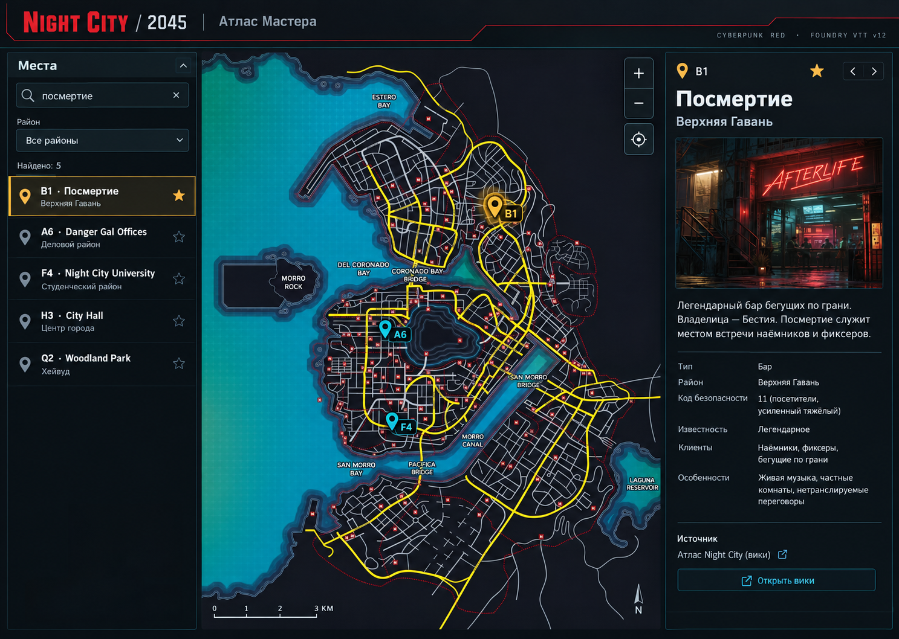
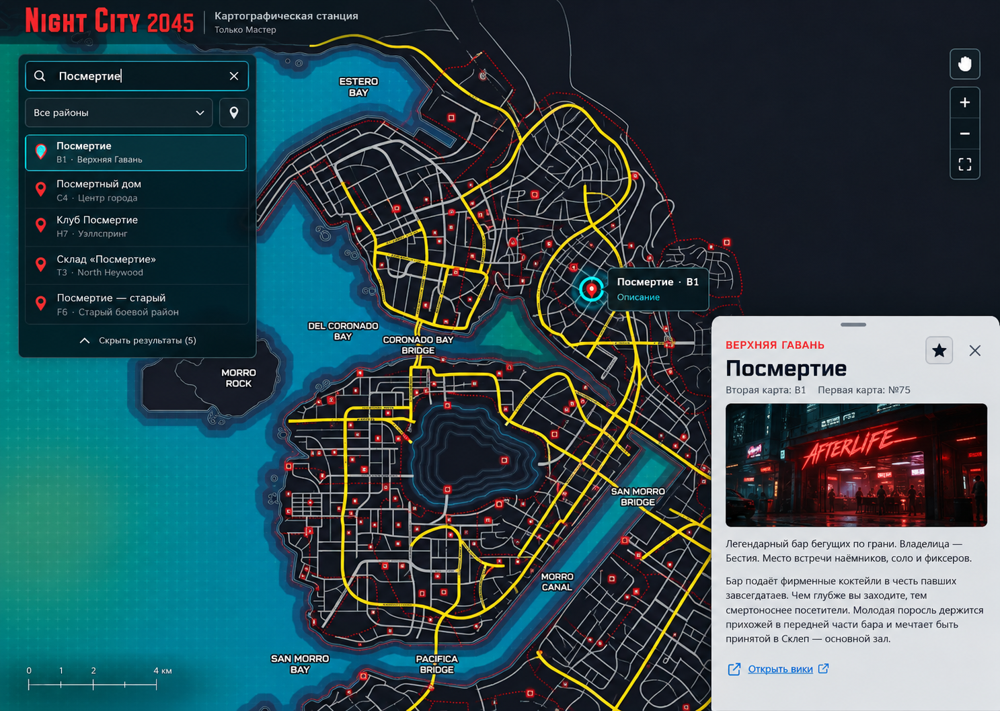
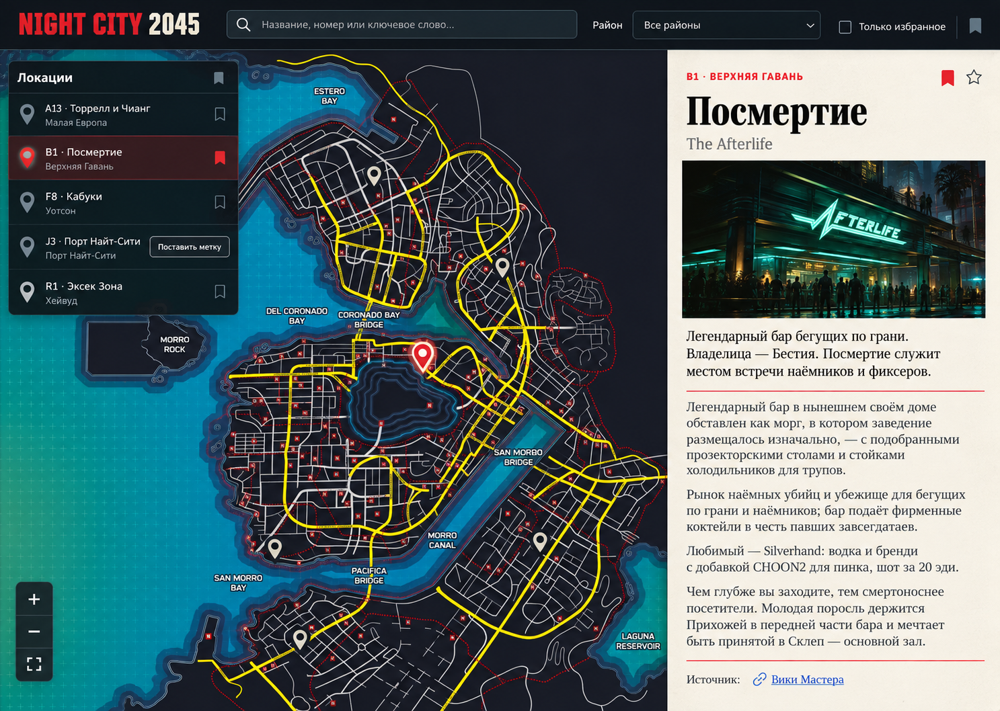
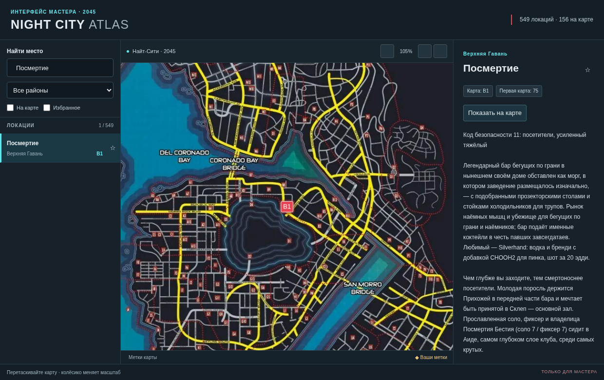
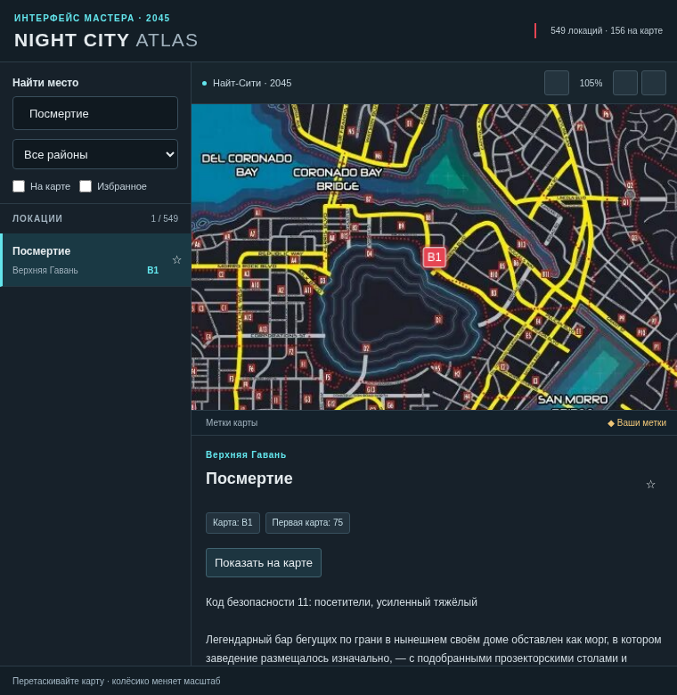

# Концепты интерфейса Night City 2045

## Задача и основная версия

Мастеру нужно быстро найти место, посмотреть его положение в городе и прочитать описание, сохраняя карту перед глазами. Выпуск 0.1.0 развивает проверенную компоновку: список слева, карта в центре, описание справа. На узком окне описание располагается под картой.

Три изображения сгенерированы через `product-design:ideate` и Image Gen с приложенными выбранной картой и существующим просмотром. Это направления оформления интерфейса. Подписи, изображения заведений и позиции на концептах иллюстративны; географию и содержание модуля определяют проверенные карта и данные вики. Иллюстрации заведений не входят в выпуск 0.1.0.

## Терминал Мастера

Три постоянные области удерживают поиск, карту и справку рядом. Тёмный графитовый фон, голубые разделители и красные акценты поддерживают язык карты. Элементы поиска и выбранной точки остаются заметными без декоративного HUD. Эта структура использована в первой версии; фактический интерфейс показан ниже.

## Картографическая станция

Карта занимает основную поверхность. Компактный поиск и результаты плавают слева; описание появляется в выдвижной области после выбора точки. Это направление полезно, когда Мастер предпочитает больше места для карты и открывает справку только по необходимости.

## Городское досье

Спокойная светлая область чтения делает длинные описания заметнее. Карта сохраняет тёмную палитру, а карточка напоминает справочник. Это направление подходит для подготовки игры и длительной работы с текстами.

## Элементы и состояния

| Элемент | Поведение в первой версии |
| --- | --- |
| Поиск | Название, алиас, код карты и подтверждённый номер первой карты; пустой результат показывает сообщение. |
| Район и переключатели | Район, только места с точкой, только избранное; одновременно фильтруют список и видимые метки. |
| Строка списка | Название, район, код точки, звезда; выбор открывает описание и показывает точку. |
| Метка карты | Обычная, выбранная, пользовательская; положение привязано к проверенным координатам или ручной метке Мастера. |
| Масштаб | Кнопки, колёсико, перемещение мышью; команда вписывания возвращает весь город. |
| Карточка | Название, район, номера карт, полный текст, источник, избранное; у места без точки доступна ручная привязка. |
| Ручная привязка | Баннер режима, щелчок внутри карты, отмена Esc, сообщение о сохранении или ошибке. |
| Избранное | Звезда отражает результат успешного сохранения; ошибка не выдаётся за сохранённое состояние. |

Текст источников отображается как обычный текст, а ссылки открываются по HTTPS. Управление доступно мышью и клавиатурой; видимый фокус и подписи кнопок поддерживают навигацию без иконок. Избранное и ручные метки хранятся в клиентских настройках Foundry.

## Фактический интерфейс 0.1.0

Скриншоты получены в Chromium на реальных данных через тестовую оболочку. Оболочка не содержит оформление и шрифт иконок Foundry; внутри Foundry используется его Font Awesome. Эти изображения подтверждают отрисовку интерфейса, а не проверку в запущенном лицензированном Foundry.

